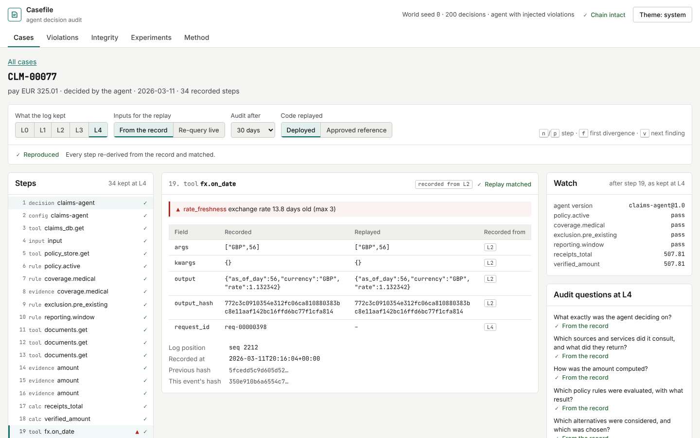
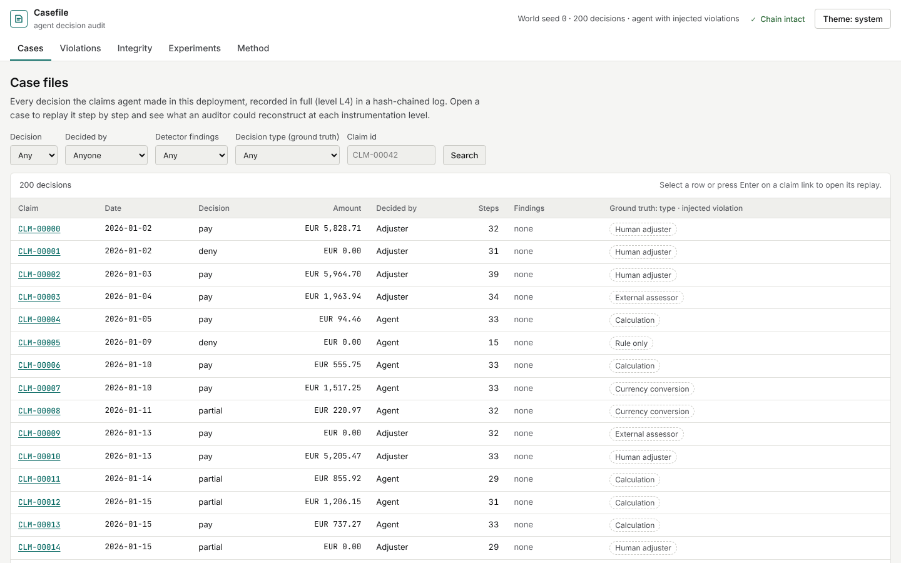
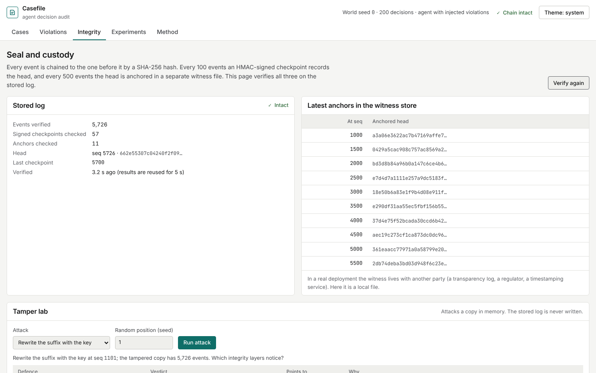
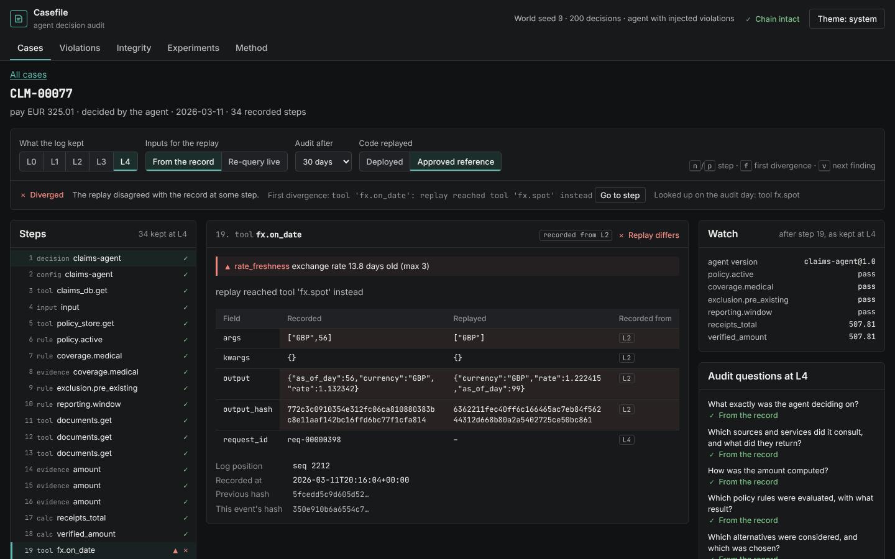
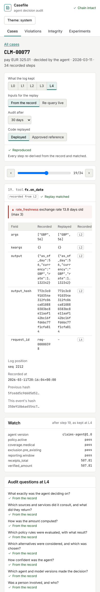

# agent-decision-audit

An audit SDK, a tamper-evident decision log, a replay engine, a policy-violation detector and a forensic console (**Casefile**) for autonomous agents. It also includes a simulation study of what an agent has to record for its decisions to be reconstructed months later.



**Scope.** Every result here comes from code that ran in this repository, on a simulated insurance-claims world with a rule-and-model agent (not a language model). The study with human auditors and the language-model agent are *Status: pending*. Full write-up: [research/REPORT.md](research/REPORT.md).

## Key findings

From [research/generated/results.md](research/generated/results.md), 20,000 decisions over 10 seeds, audited 30 days later unless noted.

- **Only a full record of the environment reconstructs a decision.** With configuration, model versions and seeds recorded (L4), record-mode replay reconstructed 100% of decisions at every delay up to 180 days. This is largely by construction; the experiment shows the SDK captures every input. No lower level fully reconstructed a single decision.
- **Recording tool outputs is the biggest single gain.** Replay followed the original route for 48.4% of decisions from output-only logs (L0), 88.1% once tool outputs were recorded (L2), and 48.2% when every source was simply re-queried live.
- **Output-only logs fail silently, and more so with time.** At L0, replays an auditor would accept but that took a different route grew from 1.4% at 30 days to 6.3% at 180 days. From L2 up, this never happened.
- **A step-level log without versions is the noisiest.** At L3, 85.5% of replays diverge, mostly because the fraud model's version was not recorded (first divergence in 81.7% of decisions).
- **Re-running the agent to fill gaps gives confidently wrong answers.** From an L2 record, replay-derived answers about alternatives, confidence and versions were wrong for 73%, 72% and 90% of decisions.
- **A third of decisions can only be attested.** 33.2% involve an adjuster, an external assessor or a random draw that can only be taken from the record, however much is logged.
- **Rules and replay catch different violations.** On full traces, rule checks found 99.9% of the violation kinds they were written for, with no false positives on 40,000 clean decisions, but 0% of a held-out evidence-substitution fault. Re-running the approved code caught 100% of both held-out kinds and missed segregation-of-duties entirely.
- **A hash chain alone does not stop truncation or an operator with the key.** The chain caught and located 100% of in-place edits, deletions, insertions and swaps, but none of the truncations or recomputed rewrites. Signed checkpoints caught 99% of rewrites without the key. Only the external anchor caught truncation (58%) and rewrites with the key (89%), and only when the change reached back past an anchor.

## Quickstart

Requires Python 3.13 with [uv](https://docs.astral.sh/uv/), and Node 22.

```bash
make setup        # uv sync --locked, npm ci
make test         # Python tests
make web          # build the console
make serve        # builds a demo deployment if missing, then serves http://127.0.0.1:8000
```

`make serve` records a demo deployment in `var/audit.db` (600 claims from an agent with injected violations, 17,708 events). A signing key and witness file are created under `var/` unless they are set in `.env` (see [.env.example](.env.example)).

Other targets:

```bash
make test-ui      # browser tests with Playwright and axe-core (needs `make web`)
make screenshots  # regenerate docs/screenshots from the running console
make experiments  # run E1–E5, then regenerate research/generated
make report       # regenerate research/generated from the committed runs
make lint         # ruff, mypy, ESLint, TypeScript
```

## How it works

```
agent ──► audit SDK ──► hash-chained log (SQLite) ──► signed checkpoints ──► witness anchors
                               │
                               ├──► replay engine   (record or live; L0–L4 projections; deployed or approved code)
                               ├──► violation checks (13 rules from a versioned audit standard)
                               └──► Casefile console (FastAPI + React)
```

1. **Record.** The SDK wraps each decision and records every step: inputs, tool calls and outputs, rules, calculations, model scores, alternatives, human decisions, and the environment (configuration, model versions, seeds). Large tool outputs are stored once as content-addressed blobs.
2. **Chain.** Each event's hash covers its canonical JSON and the previous hash. Every 100 events an HMAC-signed checkpoint is written. The head is anchored with an external witness the operator cannot overwrite (every 500 events in the demo, every 1,000 in E4).
3. **Project.** Levels L0–L4 are exact projections of the one full record, so less complete logging can be studied without re-running the agent.
4. **Replay.** The auditor re-runs the agent's code against the record. Each step is compared with what was recorded, and the result is *reproduced*, *attested*, *unverifiable*, *diverged* or *not reconstructable*.
5. **Detect.** Rule checks evaluate the recorded steps against the audit standard. Reference replay re-runs the approved code version and reports where the deployed agent differs.

## The console

| | |
|---|---|
|  |  |
| **Cases.** Every decision, with findings and filters by outcome and decision type. | **Integrity.** Verifies the live log and runs attacks on an in-memory copy to show which layer catches each. |
|  |  |
| **Reference replay.** The deployed agent's steps beside the approved code's. | **Mobile.** The replay works at phone width. |

Screenshots are captured by the browser tests, which serve a smaller deployment (200 claims).

The replay steps through a decision like a debugger: `n`/`j` next step, `p`/`k` previous, `f` first divergence, `v` toggle record and replay. Switch the level to see what a less complete log would have kept, and the delay to audit the decision later.

## Repository layout

```
src/agentaudit/      SDK, log, replay, detection, tamper attacks, simulated world and agent
  api/               FastAPI app and demo deployment
  experiments/       E1–E5 runner and report generator
configs/             one YAML file per experiment (seeds, sizes, levels, delays)
results/             committed runs: results/<experiment>/<UTC time>-<commit>/
research/            REPORT.md and generated tables and figures
web/                 Casefile console (React, TypeScript, Vite)
tests/               Python tests; tests/ui browser tests
docs/                PLAN, DESIGN, DECISIONS, METRICS, STUDY, REVIEW
data/DATASET.md      the simulated world and its ground truth
```

## Security

- The API is read-only: replays use a rebuilt copy of the simulated world and the tamper lab attacks an in-memory copy.
- It binds to 127.0.0.1 by default and refuses to serve on any other address unless `AGENTAUDIT_API_TOKEN` is set. With a token, every route except `/api/health` needs `Authorization: Bearer <token>`.
- Every client is rate limited, with a stricter limit for replays and tamper-lab runs. The integrity check is cached for 5 seconds.
- No secrets are committed. The signing key must be at least 32 bytes and comes from the environment or a file under the ignored `var/` directory.

## Limitations

- Simulated world and agent: drift rates are chosen, not measured, and an LLM agent's reasoning would not be an explicit computation.
- Rule-check recall is measured mostly on violation kinds known when the checks were written; two kinds are held out.
- The witness is a local file in the demo, and verification is O(n) in the log length.
- The demo exposes the simulation's ground truth so the console can show it; a real deployment would not have it.
- No study with people has been run ([docs/STUDY.md](docs/STUDY.md)).

## Documentation

- [docs/PLAN.md](docs/PLAN.md): research questions, hypotheses and experiments
- [docs/DESIGN.md](docs/DESIGN.md): architecture, schema and integrity design
- [docs/METRICS.md](docs/METRICS.md): metric definitions
- [docs/DECISIONS.md](docs/DECISIONS.md): design decisions and changes
- [docs/REVIEW.md](docs/REVIEW.md): internal review findings and their status
- [data/DATASET.md](data/DATASET.md): the simulated world

## License

MIT. See [LICENSE](LICENSE). To cite, see [CITATION.cff](CITATION.cff).
